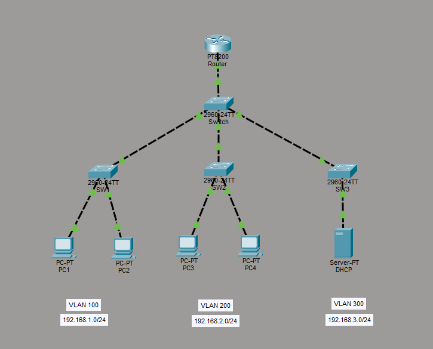
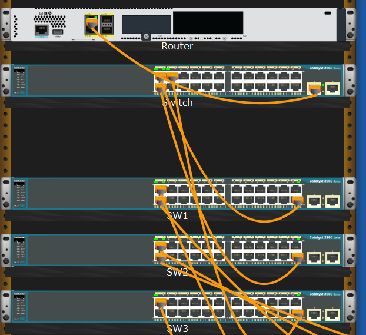
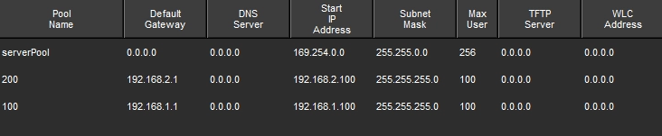
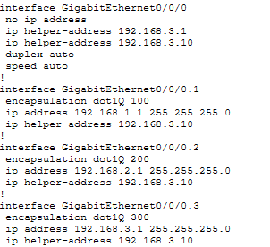
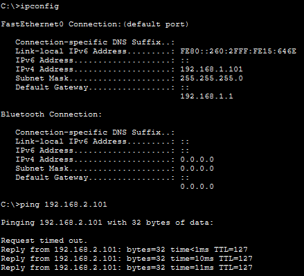

# Centralised DHCP

Cisco PT lab with the objective of creating a centralised DHCP server with DHCP relay to dynamically assign IP addresses to clients across multiple access switches and subnets.



## Step 1: Physical connection

The network consists of 3 access switches. SW1 and SW2 have 2 PCs connected, SW3 is connected to the DHCP server. The access switches are then connected to a core switch which connects to a router. I set each of the PCs IP configuration to DHCP. 



## Step 2: VLAN config

I configured 3 VLANs, all the endpoints connected to each access switch have their own VLAN. 

SW1 - VLAN 100 - IT
SW2 - VLAN 200 - Engineering
SW3 - VLAN 300 - DHCP

```bash
VLAN Config

enable
conf t
vlan 100
name IT
exit
```

```bash
Port Config

conf t
int fa0/1
switchport mode access
switchport access vlan 100
no shut
end
```

These then connect to the core switch where I configured VLAN 100 on Fa0/1, VLAN 200 on Fa0/2 and VLAN 300 on Fa0/3. I then configured Gi0/1 to be a trunk port to connect to the router.

```bash
Trunk Config

conf t
int gi0/1
switchport mode trunk
switchport trunk allowed vlan 100,200,300
no shut
end
```
## Step 3: Subinterfaces config

I kept each VLAN on a separate subnet so configured each subinterface to have an appropriate default gateway.

```bash
Subinterfaces Config

enable
conf t
int gi0/0/0
no shut
exit

int gi0/0/0.1
encapsulation dot1Q 100
ip address 192.168.1.1 255.255.255.0

int gi0/0/0.2
encapsulation dot1Q 200
ip address 192.168.2.1 255.255.255.0

int gi0/0/0.3
encapsulation dot1Q 300
ip address 192.168.2.1 255.255.255.0
end
```

## Step 4: DHCP config

I set a static IP of 192.168.3.10/24 on the DHCP server and then created 2 pools so that each subnet with PCs connected has a pool.

Pool ‘100’ with a default gate way of 192.168.1.1 starting at 192.168.1.100.
Pool ‘200’ with a default gateway of 192.168.2.1 starting at 192.168.2.100.



After this I went back to the router to configure DHCP relay which I did for each configured interface.

```bash
DHCP Relay Config

Router

enable
conf t 
int gi0/0/0.1
ip address-helper 192.168.3.10
end
```



## Step 5: Confirming functionality

I went onto CMD on PC1 to confirm that DHCP was now functional by running ‘ipconfig’. Once I confirmed that an IP in the DHCP pool had successfully applied, I did a ping test to a PC in the other subnet to confirm connectivity.


